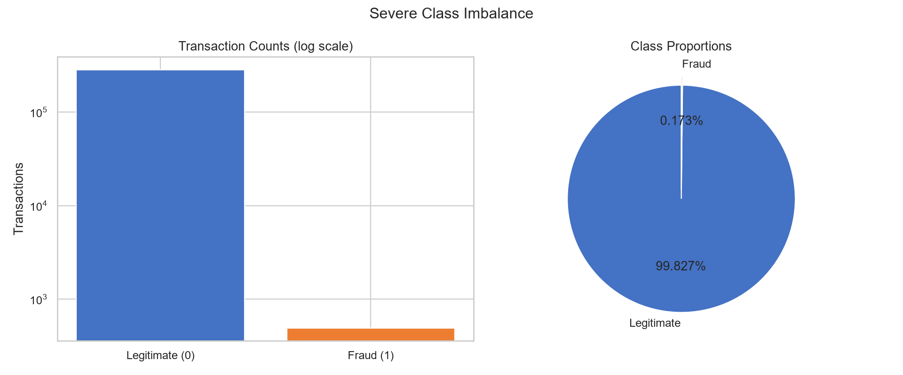
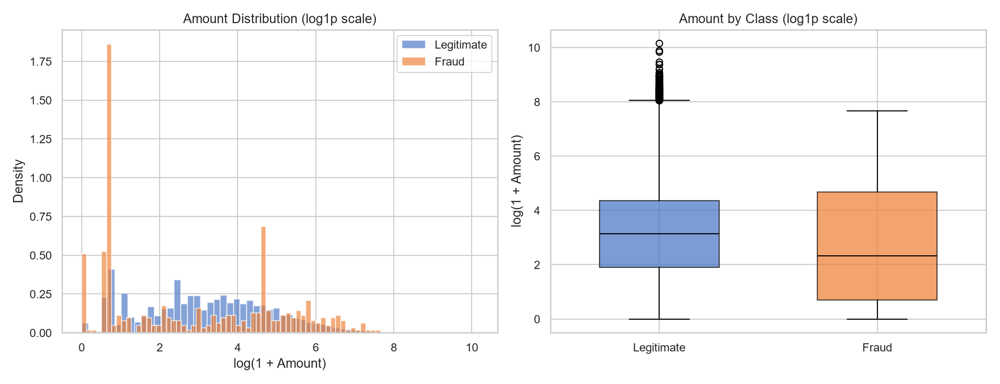
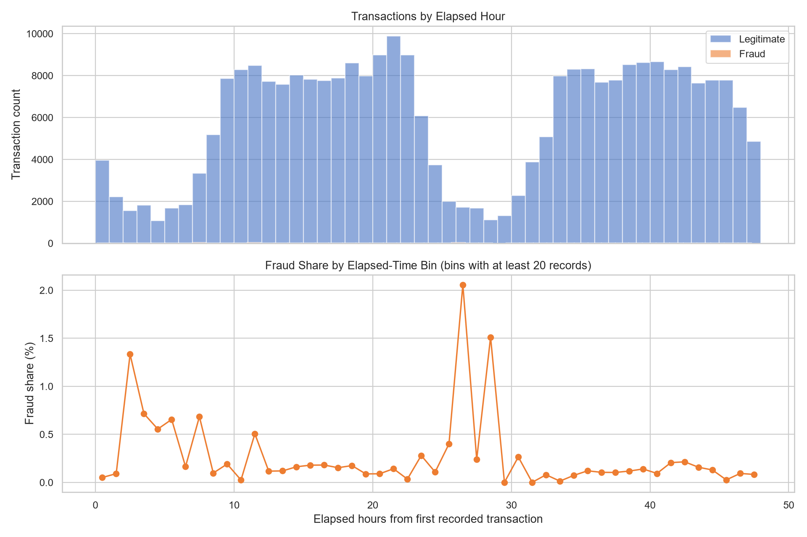
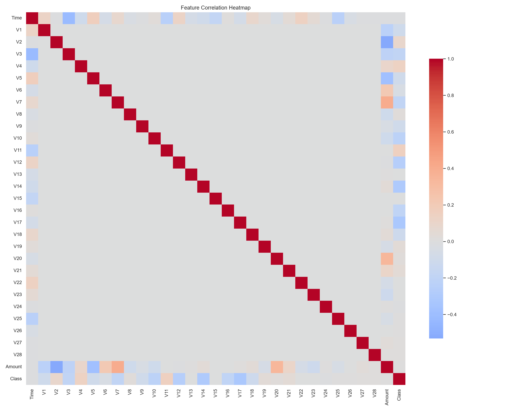
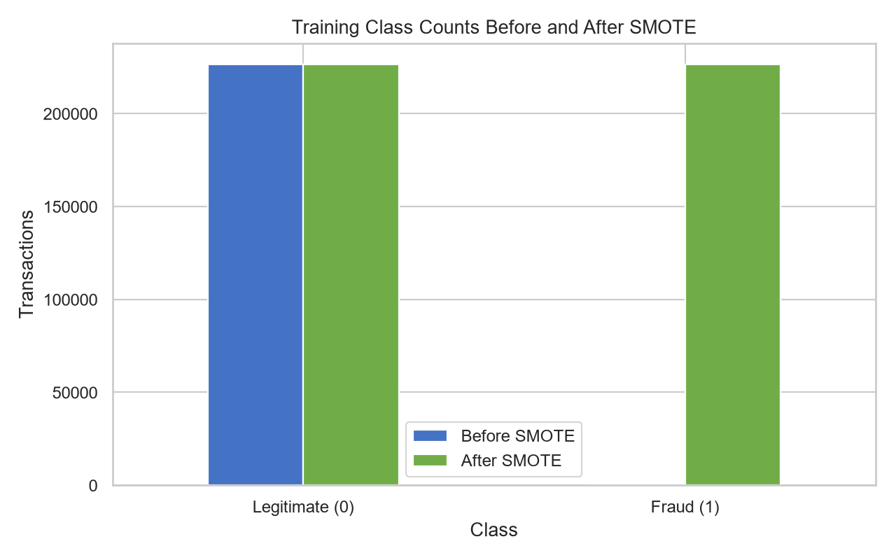
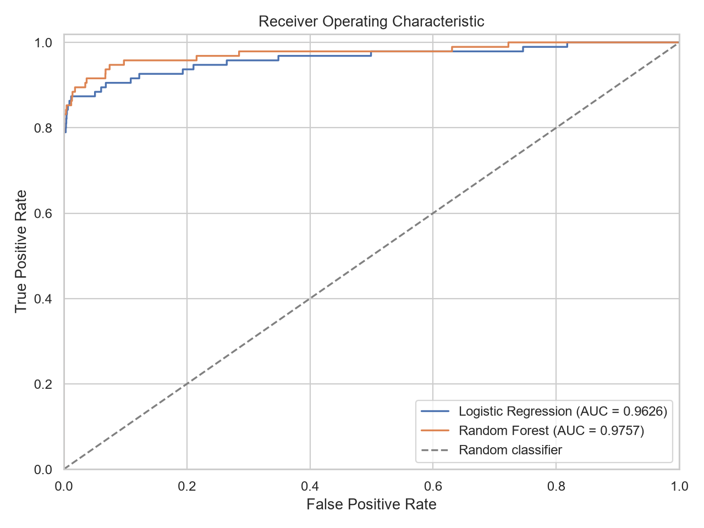
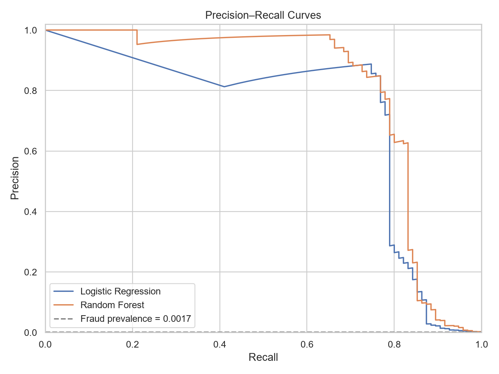
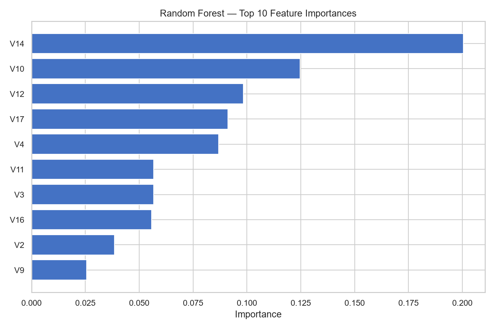
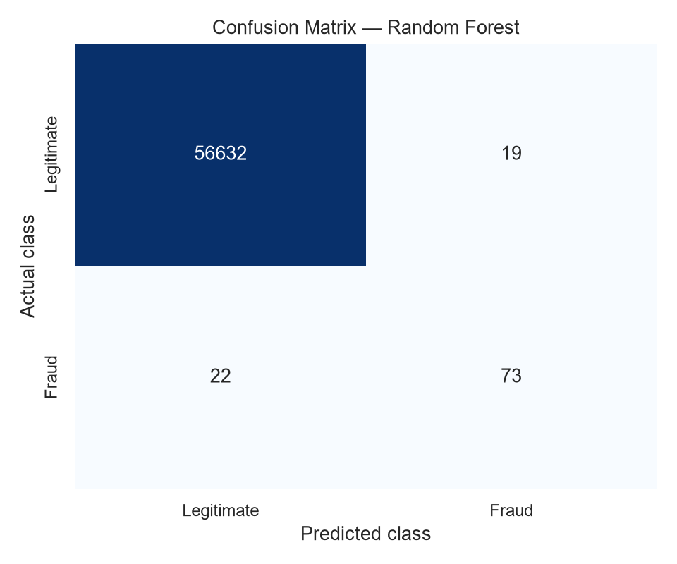

# Credit Card Fraud Detection Using Machine Learning

**Oasis Infobyte (OIBSIP) · Data Analytics Internship · Level 2 · Task 3 — Fraud Detection**

This project compares Logistic Regression and Random Forest on the public European credit-card fraud benchmark. Its central challenge is severe class imbalance: fraudulent transactions are rare, so accuracy alone cannot tell whether a model catches fraud. The notebook and Python scripts use a stratified holdout split, apply SMOTE only inside training pipelines, and evaluate both models on the same untouched test set.

## Dataset and provenance

- **Source dataset:** [Kaggle — Credit Card Fraud Detection](https://www.kaggle.com/datasets/mlg-ulb/creditcardfraud)
- **Benchmark mirror used for this run:** [Hugging Face dataset repository](https://huggingface.co/datasets/JEFFREY-VERDIERE/Creditcard)
- **Expected benchmark:** 284,807 records, 492 fraud cases, 30 numeric features plus `Class`.
- `Class = 0` is legitimate and `Class = 1` is fraud. `Time` is elapsed seconds from the first recorded transaction, not a calendar date or clock time.
- The raw CSV is approximately 151 MB, above GitHub's 100 MB per-file limit. It is intentionally ignored by Git; follow [data/raw/README.md](data/raw/README.md) to download it after cloning. The local raw file is preserved and never modified.
- The generated processed CSV is also approximately 151 MB and is Git-ignored; it can be regenerated from the raw CSV.
- The raw file contains 1,081 exact duplicate rows. These are reported and removed from the modeling copy before splitting so identical transactions cannot leak across train and test. The original CSV remains unchanged.

## Methods

1. Inspect rows, types, missing values, exact duplicates, target values, and class proportions.
2. Keep the 28 anonymized `V1`–`V28` features and include `Time` and `Amount`; exclude `Class` from model features.
3. Use a reproducible 80/20 split with stratification before any oversampling.
4. Fit `StandardScaler`, SMOTE, and each estimator in an `imbalanced-learn` pipeline. Scaling and oversampling therefore fit on training data only; test data is never resampled.
5. Compare Logistic Regression and a bounded Random Forest with accuracy, precision, recall, F1-score, ROC-AUC, classification reports, confusion matrices, ROC curves, and Precision–Recall curves.
6. Save fitted model pipelines (including preprocessing) with joblib and inspect up to ten errors for the selected model.

Recall is important because missed fraud can cause financial loss, while precision matters because false alarms inconvenience customers and cost investigators time. We prioritize recall while checking precision and F1 rather than selecting on accuracy alone. The 0.5 probability threshold is left unchanged; tuning it would require a separate validation set.

## Project structure

```text
DataAnalytics-L2-FraudDetection/
├── data/
│   ├── raw/creditcard.csv              # downloaded separately; git-ignored (>100 MB)
│   └── processed/processed_transactions.csv # generated locally; git-ignored (>100 MB)
├── notebooks/Fraud_Detection_Analysis.ipynb
├── src/
│   ├── data_preprocessing.py
│   ├── model_training.py
│   └── evaluation.py
├── models/
│   ├── logistic_regression_model.joblib
│   └── random_forest_model.joblib
├── reports/
│   ├── class_imbalance_report.csv
│   ├── model_comparison.csv
│   ├── classification_reports.txt
│   ├── feature_importance.csv
│   └── misclassified_examples.csv
├── visualizations/
├── requirements.txt
├── LICENSE
└── README.md
```

## Exploratory analysis and visualizations

All charts below are generated by the notebook and reusable pipeline:













## Actual model results

These are the calculated metrics from the stratified, de-duplicated test split (56,746 records; 95 fraud cases), using each model's default 0.5 threshold:

| Metric | Logistic Regression | Random Forest |
|---|---:|---:|
| Accuracy | 0.973672 | 0.999277 |
| Precision | 0.053035 | **0.793478** |
| Recall | **0.873684** | 0.768421 |
| F1-score | 0.100000 | **0.780749** |
| ROC-AUC | 0.962618 | **0.975715** |

The recall-first selection is Logistic Regression because it detected 83 of 95 fraud cases in this test split. Its precision was only 5.30%, so it also incorrectly flagged many legitimate transactions; it should not be used for automatic payment blocking without validation-based threshold selection and an explicit false-alert cost analysis. Random Forest had much stronger precision, F1, and ROC-AUC, with moderately lower recall. Accuracy alone favors neither a responsible fraud-screening choice nor an understanding of the trade-off.

The full-CSV class counts were 284,315 legitimate and 492 fraudulent transactions (0.172749%). After 1,081 exact duplicates were removed, stratification yielded 283,726 modeling records: 226,980 training records (378 fraud) and 56,746 test records (95 fraud). SMOTE balanced only the training partition to 453,204 records; the test distribution was not altered. Random Forest's highest impurity importance was V14 (0.2005), followed by V10 (0.1247) and V12 (0.0983); these are predictive associations, not causal explanations. See [reports/model_comparison.csv](reports/model_comparison.csv) and [reports/classification_reports.txt](reports/classification_reports.txt) for the generated reports.

## Scalability discussion

One million transactions per hour is about **278 transactions per second**. A production design could ingest events with Kafka, compute low-latency features, call a horizontally scaled FastAPI scoring service, cache appropriate features in Redis, persist decisions and alerts to a database, and monitor latency, drift, precision, and recall for retraining. Meeting a throughput target requires load testing, fault handling, infrastructure planning, privacy controls, and human review; this beginner project does not deploy those services and is not connected to a bank or payment gateway.

## Limitations

- This historical, anonymized benchmark is not representative of every issuer, country, or current fraud pattern.
- Feature meanings for `V1`–`V28` are not provided, limiting business interpretation.
- A high offline score does not establish production safety; temporal drift, delayed labels, transaction costs, and operational review are not modeled.
- SMOTE creates synthetic training examples; it does not make the real-world classes balanced.
- Feature importance shows predictive contribution, not causation.

## Installation and use

Use Python 3.11 or newer. From this project folder:

```bash
python -m pip install -r requirements.txt
```

Download `creditcard.csv` from the linked Kaggle dataset (or the benchmark mirror) into `data/raw/`. Then run:

```bash
python src/data_preprocessing.py
python src/model_training.py
python src/evaluation.py
```

For metrics, curves, error analysis, and model inference demonstration:

```bash
jupyter notebook
```

Open `notebooks/Fraud_Detection_Analysis.ipynb` and run all cells. Model and report artifacts are regenerated locally; the notebook additionally generates the exploratory-analysis charts. The source scripts use the same split, pipeline, and evaluation logic as the notebook.

## Acknowledgement

Prepared for the Oasis Infobyte Data Analytics Internship, Level 2, Task 3. Thanks to Oasis Infobyte for the learning opportunity and to the Kaggle dataset authors for the public benchmark.

## License

The project code is provided under the MIT License. The dataset remains subject to its own source and repository terms; this project license does not relicense the data.
